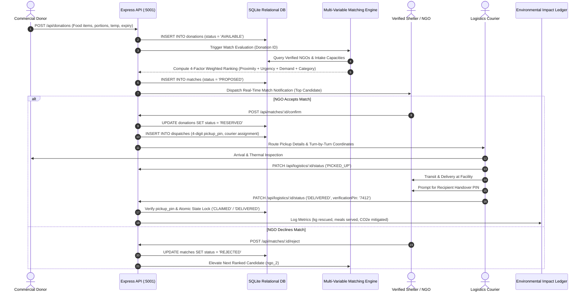

# 🌾 SurplusLink — Smart Algorithmic Food Redistribution Platform

[](https://github.com/surpluslink/core)
[](https://opensource.org/licenses/MIT)
[](https://github.com/surpluslink/core/releases)
[](https://nodejs.org/)
[](https://expressjs.com/)
[](https://www.sqlite.org/)
[](https://react.dev/)
[](https://tailwindcss.com/)

> **A mission-critical, full-stack logistics platform bridging commercial food surplus generators (banquets, hotels, corporate canteens, bakeries) with vetted hunger-relief shelters and NGOs before perishability windows close.**

---

## 🧭 Problem & Impact Statement

Over **1.3 billion metric tons** of edible food is discarded globally each year, while local shelters frequently face critical food deficits. Traditional manual redistribution relies on phone calls and spreadsheets, taking 6–18 hours—far exceeding the safe 2–6 hour shelf-life window of cooked food.

**SurplusLink** replaces ad-hoc logistics with an automated, multi-variable matching engine, geodesic proximity tracking, decay-aware urgency scoring, cryptographic 4-digit handover PIN verification, and real-time environmental accounting (measuring averted $\text{CO}_2$ emissions and conserved virtual water).

---

## 🔄 Matching & Logistics Workflow

The end-to-end lifecycle of a surplus listing moves through deterministic state transitions to eliminate food spoilage, prevent double-claiming, and maintain chain-of-custody integrity:



---

## ⚡ Key Platform Capabilities

### 1. Multi-Role Operating Experience
- **Provider / Donor Portal:** Rapid-entry modal capturing SKU category (Cooked Meals, Bakery, Fresh Produce, Dairy), batch size (kg & portion count), preparation time, safe consumption deadline, storage temperature requirements (`CHILLED_4C`, `HOT_HOLD_60C`, `AMBIENT`), and FSSAI dietary classifications.
- **Recipient / Shelter Feed:** Live, countdown-driven inventory stream displaying usable hours remaining, distance in kilometers, donor trust ratings, and verified allergen tags.
- **Logistics & Dispatch Console:** Real-time courier telemetry tracker with electric vehicle (EV) fleet information, active route state badges (`ASSIGNED`, `PICKED_UP`, `DELIVERED`), and secure PIN confirmation.

### 2. Algorithmic Candidate Ranking Engine
Evaluates every active NGO in near real-time across four continuous scoring dimensions:
$$\text{MatchScore} = (0.35 \times S_{\text{dist}}) + (0.25 \times S_{\text{urgency}}) + (0.25 \times S_{\text{demand}}) + (0.15 \times S_{\text{cat}})$$

Where:
- **Geodesic Distance ($S_{\text{dist}}$):** Derived via the Haversine formula over WGS84 coordinates:
  $$d = 2R \arcsin\left(\sqrt{\sin^2\left(\frac{\Delta \phi}{2}\right) + \cos(\phi_1)\cos(\phi_2)\sin^2\left(\frac{\Delta \lambda}{2}\right)}\right)$$
  Normalized using an exponential decay curve over maximum logistics radius.
- **Urgency Decay ($S_{\text{urgency}}$):** Ratio of elapsed shelf-life to total permissible consumption window.
- **Demand Fit ($S_{\text{demand}}$):** Alignment between surplus batch quantity and the NGO's real-time daily unmet deficit gap:
  $$\text{DemandFit} = \min\left(1.0, \frac{\text{quantity\_kg}}{\text{daily\_predicted\_demand\_kg} - \text{fulfilled\_today\_kg}}\right)$$
- **Category Compatibility ($S_{\text{cat}}$):** Exact string matching against dietary permissions and refrigerated handling capabilities.

### 3. Claim Verification & Handover Security
- Generates a cryptographically random 4-digit numerical verification PIN upon match confirmation.
- Only the receiving shelter holds the destination PIN; couriers cannot mark a donation as `DELIVERED` without on-site recipient PIN entry.
- Empty, falsified, or mismatched PIN submissions are rejected with HTTP 400 Bad Request.

---

## 📊 Data Model & State Management

### Database Schema Overview
The relational SQLite persistence layer strictly enforces atomic state locking and foreign key referential integrity:

```
[ donors ] (donor_id PK, name, org_type, latitude, longitude, rating, verified)
     │
     └──< [ donations ] (donation_id PK, donor_id FK, food_name, quantity_kg, expiry_time, status)
               │
               ├──< [ matches ] (match_id PK, donation_id FK, ngo_id FK, match_score, rank, status)
               │         │
               │         └──< [ dispatches ] (dispatch_id PK, match_id FK, pickup_pin, status)
               │
               └──< [ impact_ledger ] (log_id PK, donation_id FK, kg_rescued, co2_mitigated_kg)

[ ngos ] (ngo_id PK, name, latitude, longitude, daily_intake_capacity_kg, preferred_food_types)
     │
     └──< [ ngo_demand_forecast ] (forecast_id PK, ngo_id FK, daily_predicted_demand_kg, unmet_gap_kg)
```

### State Machine & Concurrency Protection
To prevent double-claiming during simultaneous browser interactions:

| State | Allowed Transitions | Description |
| :--- | :--- | :--- |
| **`AVAILABLE`** | `RESERVED`, `EXPIRED` | Newly registered surplus batch open for candidate matching. |
| **`RESERVED`** | `PICKED_UP`, `AVAILABLE` | Candidate accepted; 4-digit PIN generated; locked from other shelters. |
| **`PICKED_UP`** | `DELIVERED` | Courier validated pickup at provider site; in physical transit. |
| **`DELIVERED`** | *Terminal State* | Verified on-site by recipient PIN; impact permanently ledgered. |
| **`EXPIRED`** | *Terminal State* | Safe consumption countdown elapsed before courier dispatch. |

---

## 🚀 End-to-End Local Setup

### 1. Prerequisites
- **Node.js:** `>= 20.0.0` (Verified on Node v24.20.0 LTS)
- **npm:** `>= 10.0.0`
- **Git**

### 2. Clone & Inspect Repository
```bash
git clone <repository-url> surplus-link
cd surplus-link
```

### 3. Environment Configuration
Create a `.env` file in `server/` (or copy `.env.example`):
```bash
cp server/.env.example server/.env
```

| Key | Default | Description |
| :--- | :--- | :--- |
| `PORT` | `5001` | HTTP port for Node.js Express backend and static SPA delivery |
| `NODE_ENV` | `development` | Runtime environment mode |
| `DB_PATH` | `./data/surplus_link.db` | Relative path to persistent SQLite database |
| `CORS_ORIGIN` | `http://localhost:3001` | Allowed CORS origins for Vite development server |

### 4. Install Dependencies
```bash
# Install backend dependencies
cd server && npm install && cd ..

# Install frontend dependencies
cd client && npm install && cd ..
```

### 5. Seed Database & Run Automated Verification
```bash
# Seed 5 enterprise donors, 5 verified NGOs, active surplus listings, and dispatch dispatches
npm run seed

# Run the 10-step automated E2E integration test suite
npm test
```

### 6. Launch Application
```bash
# Option A: Start production standalone server (serves both API & Frontend on http://localhost:5001)
npm start

# Option B: Launch client Vite hot-reloading dev server (runs on http://localhost:3001)
npm run dev
```

---

## 📁 Folder Structure

```
surplus-link/
├── package.json               # Standalone workspace runner (start, dev, seed, test)
├── test.js                    # 10-step E2E automated integration test suite
├── .gitignore                 # Ignores node_modules, build dist, and *.db files
├── README.md                  # Comprehensive architectural documentation
│
├── server/                    # Node.js + Express Backend Layer
│   ├── package.json           # Backend dependencies (express, cors)
│   ├── data/                  # SQLite persistent database storage (.gitignored)
│   └── src/
│       ├── index.js           # Server entry point & static SPA fallback router
│       ├── controllers/       # HTTP request handlers (donation, match, logistics, analytics)
│       ├── services/          # Pure business logic (matchingEngine, donationService)
│       ├── repositories/      # Database abstraction layer (prepared SQL statements)
│       ├── routes/            # REST API route definitions
│       ├── middleware/        # Error handlers & request logging
│       └── db/                # SQLite connection (`DatabaseSync`) & schema migrations
│
└── client/                    # React 19 + Vite Frontend SPA Layer
    ├── package.json           # Frontend dependencies (react 19, vite, tailwindcss v4, lucide)
    ├── vite.config.js         # Vite configuration with Tailwind CSS plugin
    ├── index.html             # HTML entry point with typography preloading
    └── src/
        ├── main.jsx           # React DOM root bootstrapping
        ├── App.jsx            # Master layout, navigation tabs, and state coordination
        ├── index.css          # Tailwind CSS v4 directives & custom paper-grain overlay
        ├── services/          # Client-side API client wrapper (fetch abstraction)
        └── components/        # Bespoke Organic Editorial Luxury UI Components
            ├── Navbar.jsx                   # Sticky navigation header with impact counter
            ├── HeroBanner.jsx               # Nyalazone editorial introductory hero
            ├── DonationFeed.jsx             # Active surplus cards with live countdown timers
            ├── MatchModal.jsx               # Candidate NGO ranking & decline/accept modal
            ├── RegisterDonationModal.jsx    # Donor food intake form with client validations
            ├── LogisticsTracker.jsx         # Courier dispatch tracker with 4-digit PIN modal
            ├── DemandPredictionDashboard.jsx# Real-time shelter intake gap analytics
            ├── ImpactDashboard.jsx          # Historical carbon & water mitigation charts
            └── NgoDirectory.jsx             # Directory of FSSAI verified recipient shelters
```

---

## 📄 License

This project is licensed under the **MIT License** — see the [LICENSE](LICENSE) file for details. Built for enterprise supply-chain resilience and zero food waste.
